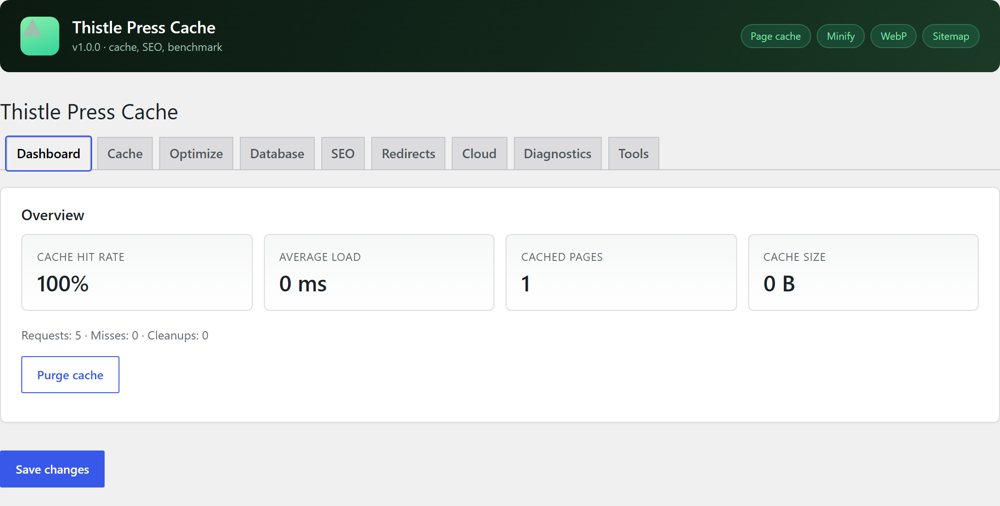
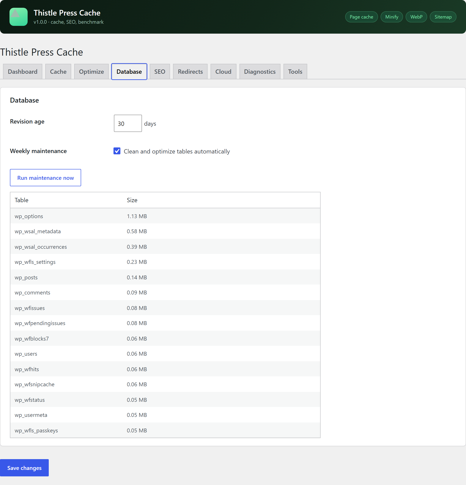
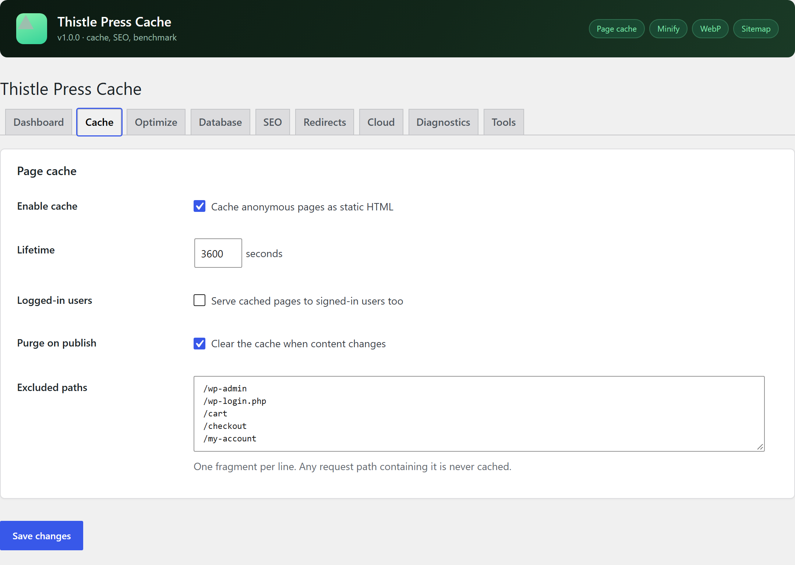

# Thistle Press Cache — open source wordpress clear cache

Most speed plugins sell a dashboard. Thistle Press Cache writes static HTML, strips the whitespace nobody reads, converts images to modern formats and prunes the tables that grow every day — then shows the counters it recorded while doing it.

## Why Thistle Press Cache for open source wordpress clear cache

Because the same plugin that writes the cache also decides what is worth minifying, which images to convert and when a table is big enough to optimise. One pipeline, one set of counters, no coordination between plugins.

Thistle Press Cache is 4,514 lines across 20 files — smaller than most single-purpose plugins, because the features share one settings model and one output pipeline instead of each bringing its own. That is also why the uninstall is clean.

## Static HTML for anonymous visitors

Anonymous requests are served from a static file with no PHP boot. The cache is purged on publish, on comment, on theme switch and on a manual click, and it honours path exclusions so carts, checkouts and account pages never see a cached copy. Hit, miss and render-time counters are recorded per page.

## Optional benchmark

The benchmark is the only feature that talks to the network. It is off until you press the button, the request body is shown in full before it leaves, and the result is cached locally. If the service is unreachable the tab says so instead of hanging.

## Cleanup and optimisation

Revisions are aged out past a configurable window, spam and trashed posts are removed, orphaned post meta is swept, expired transients are dropped and tables are optimised on a weekly schedule. A per-table size report tells you which one is actually growing before you do anything drastic.

## Automation

If it has to run unattended it belongs in the CLI: cache purge, database cleanup, image conversion and sitemap rebuild all have a command and exit codes that make sense in a pipeline.

## 404 log and redirects

Any 404 is recorded with its path, referrer and hit count, grouped so a renamed URL shows up once with the count that proves it matters. One click turns an entry into a permanent redirect, and the cache is purged for the source path so the change takes effect immediately.

## Environment checks

Everything the plugin needs to know about its host in one screen, plus backups of the settings as a JSON file. Import validates the shape before writing, so a truncated export cannot leave the plugin in a half-configured state.

## Output filtering

The output buffer is filtered once: whitespace between tags collapses, comments go, emoji detection and the embed script are removed. Image decoding is set async, the hero image gets fetch priority, and script deferral is available but off by default because it breaks more themes than it fixes.

## Screenshots

*Cache hit rate, average load and cache size after a week of traffic*

*Revision ageing, orphan meta and table sizes*

*Cache TTL, exclusions and manual purge*

## Install

**Three ways in**

- **Release ZIP** — `thistle-press-cache-1.0.1.zip` from [releases](https://github.com/ArbiterPulley/open-source-wordpress-clear-cache/releases/latest), then *Plugins → Add New → Upload Plugin*.
- **Git clone** — `git clone https://github.com/ArbiterPulley/open-source-wordpress-clear-cache wp-content/plugins/thistle-press-cache`, then activate.
- **WP-CLI** — `wp plugin install https://github.com/ArbiterPulley/open-source-wordpress-clear-cache/releases/latest/download/thistle-press-cache-1.0.1.zip --activate`

## Configuration

After activation open **Thistle Press Cache** in the sidebar. The defaults are usable on most installs: cache on, one-hour TTL, revisions aged at 30 days. Two things are worth adjusting early — list the paths that must never be cached (cart, checkout, account), and turn the minifier off if a page builder already does it.

## Requirements

- **WordPress** 6.0 or newer
- **PHP** 7.4 or newer — 8.1+ if your host offers it, mainly for OPcache defaults
- **Database** MySQL 5.7+ or MariaDB 10.3+
- **Multisite** yes, settings per site
- **WP-CLI** optional but useful: `wp thistle-press-cache cache purge`

## Performance notes

The dashboard numbers are recorded, not modelled: the cache write timestamps the render, the hit counter increments per served document, and the size figures come from `stat()` on the files on disk. A page that was never cached shows no hit.

## Switching over

Deactivate the old cache plugin first so its drop-in and `.htaccess` rules are removed, install Thistle Press Cache, purge once, then check three pages: the front page, a paginated archive and a product or post with a comment form. Old cache directories can be deleted by hand; nothing in this plugin reads them.

## Tested against

Works with common page builders when their own minifier is disabled, with object-cache drop-ins (the plugin detects one and leaves transients alone), with multisite per-site settings, and with the usual security plugins — the admin screens are capability-checked and nonce-protected, so nothing gets caught in a request filter.

## Frequently asked

**Does it support PHP 8.3?** Yes, and 7.4 upwards. The plugin avoids syntax that would pin it to one version, which is why it runs on older shared hosts without a deprecation storm.

**Why is my home page not cached?** Most often a cookie: sessions, carts and commenters bypass the cache by design. Second most often an exclusion that became too broad — the Diagnostics tab lists the rules that currently apply to a path.

**What happens on uninstall?** Deactivation stops caching and removes the cron events. Deleting the plugin runs the uninstall script: redirect table dropped, cache directory emptied, every option with the plugin prefix removed. Settings backups stay where you put them.

**Does it handle Core Web Vitals?** It does not ship a field-data collector. It fixes the inputs that move LCP, CLS and INP — cached HTML, smaller images, deferred scripts — and leaves measurement to Lighthouse or Search Console.

**Does it work on shared hosting?** Yes, as long as the cache directory is writable — the Diagnostics tab checks that explicitly. No Redis, no shell access and no PHP extension beyond the usual set is required.

## Uninstall

Deactivating removes the cron events and stops caching immediately. Deleting the plugin through the admin runs the uninstall script, which drops the redirect table, empties `wp-content/cache/thistle-press-cache` and deletes every option carrying the plugin prefix. Backups you created stay in `wp-content/uploads/thistle-press-cache-backups`.

## License

MIT — see [LICENSE](LICENSE). Bug reports go to the issue tracker with the version and the PHP version attached. Security reports go through the private advisory flow in [SECURITY.md](SECURITY.md).
